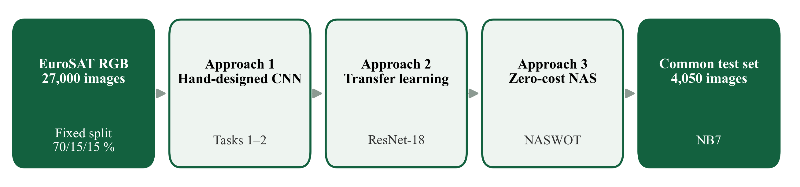
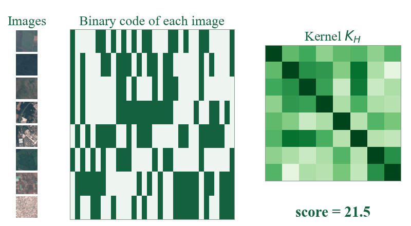
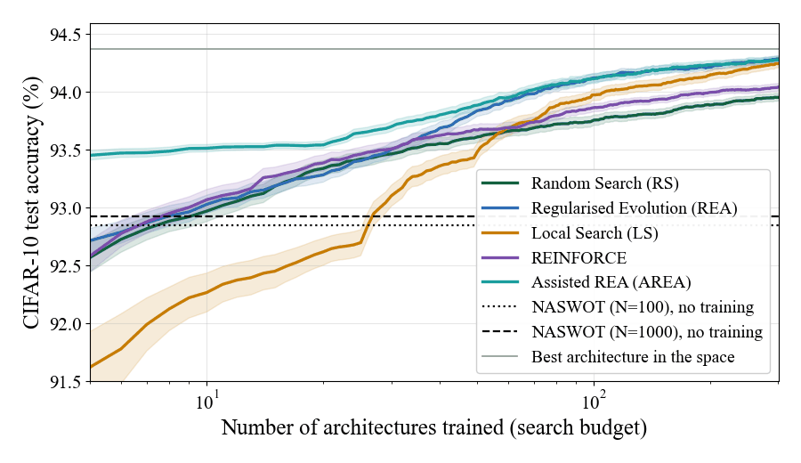
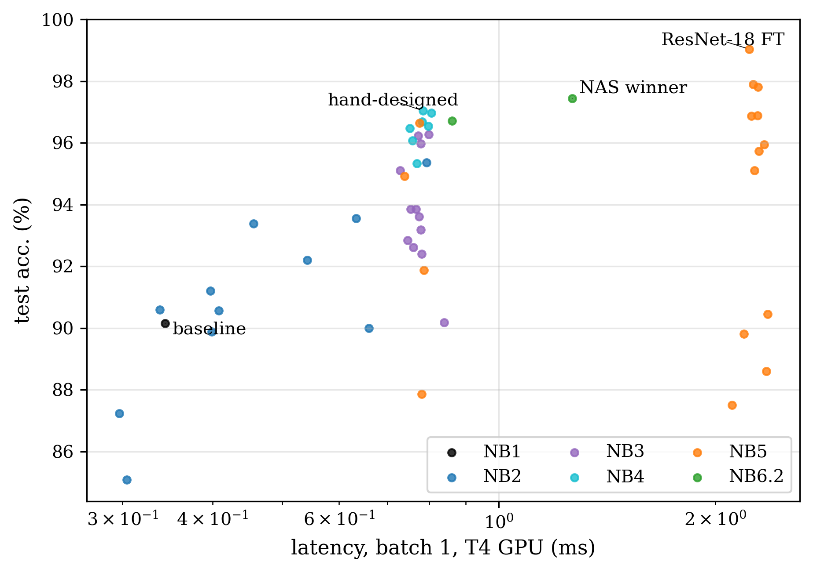

<div align="center">

# Designing CNNs for Satellite Image Classification

**Hand-design, transfer learning and training-free Neural Architecture Search on EuroSAT**

Master 2 Artificial Intelligence and Data Engineering · AIDE500 Programming for AI

[Technical report](docs/aide500/AIDE500_Report.pdf) ·
[Slides](docs/aide500/AIDE500_Presentation.pdf) ·
[Scientific English report](docs/english/Scientific_Report.pdf) ·
[Notebooks](notebooks/) ·
[Checkpoints](../../releases)

</div>

---

## Overview

How do you get a good image classifier for a new dataset? This project compares three answers on
**EuroSAT** (27,000 Sentinel-2 satellite images, 10 land-use classes), using the same data split
and the same evaluation for every model:

| | Approach | Idea |
|:-:|---|---|
| 1 | **Hand-design** | Start from a baseline CNN and improve it one factor at a time: architecture, optimiser, learning-rate schedule, data augmentation |
| 2 | **Transfer learning** | Fine-tune an ImageNet-pretrained ResNet-18 with 5% to 100% of the training data |
| 3 | **Training-free NAS** | Score 1,000 *untrained* networks with NASWOT ([Mellor et al., 2021](https://arxiv.org/abs/2006.04647)) and train only the best ones |

<p align="center"></p>

## Key results

| Model | Test accuracy | Parameters | Design cost |
|---|:-:|:-:|:-:|
| Baseline CNN | 90.15% | 2.19 M | — |
| Hand-designed CNN (after the ablation study) | 97.04% | 1.24 M | 203 GPU-min |
| **NASWOT-searched CNN** | **97.43%** | 1.99 M | **17 GPU-min** |
| **ResNet-18, fully fine-tuned** | **99.04%** | 11.18 M | — |

- **Transfer learning wins on accuracy** and is remarkably data-efficient: **95.95% with only 5% of the training data** (945 images).
- **Training-free search beats manual design**: +0.7 points of accuracy with **12× less GPU time**. It rediscovered the conclusions of the manual study (depth, small kernels, BatchNorm) and added residual connections.
- **The NASWOT paper was reproduced** on NAS-Bench-201 before being trusted on EuroSAT:

  | Kendall τ (score vs. final accuracy) | Ours | Paper |
  |---|:-:|:-:|
  | CIFAR-10 | 0.602 | 0.574 |
  | CIFAR-100 | 0.640 | 0.611 |
  | ImageNet16-120 | 0.600 | 0.549 |

  Search with N = 100 on CIFAR-10: **92.83 ± 0.94%** (ours) vs. 92.81 ± 0.99% (paper).
- **NASWOT vs. five search strategies** (200 runs each on NAS-Bench-201): NASWOT without any training matches training ~10 random networks; regularised evolution with 100 trained networks is better (94.1%) but far more expensive; **seeding evolution with NASWOT is best at small budgets**.

<p align="center">
  
  
</p>
<p align="center"></p>

## How NASWOT judges a network without training it

For a mini-batch of $B$ images, every image $i$ gets a binary code $c_i \in \{0,1\}^{N_A}$ recording which of the
$N_A$ ReLU units it activates in the untrained network. Two images with the same code lie in the same linear region
and cannot be separated. The kernel

$$K_H[i,j] = N_A - d_H(c_i, c_j), \qquad s = \log\left|\det K_H\right|$$

is close to diagonal when the codes are all different, so a high score $s$ predicts a network that trains well.
One forward pass is enough: about 0.1 s per architecture, so 1,000 EuroSAT candidates are scored in 153 s.

## Repository structure

```
├── notebooks/                 # NB0–NB7, executed on Kaggle (outputs included)
│   ├── NB0_Setup_Data                     stratified 70/15/15 split
│   ├── NB1_Baseline_CNN                   baseline CNN, training loop
│   ├── NB2_Architecture_Variations        depth, kernels, padding, BatchNorm, FC head
│   ├── NB3_Optimizers_LR_Schedulers       SGD / Adam / AdamW × LR × StepLR / Cosine / OneCycle
│   ├── NB4_Data_Augmentation              flips, crops, affine, colour jitter, MixUp, CutMix
│   ├── NB5_Transfer_Learning              ResNet-18 frozen / partial / full, 5–100% of data
│   ├── NB6_0_NASBench201_Extract          ground-truth accuracies of 15,625 architectures
│   ├── NB6_1_NASBench201_Reproduction     NASWOT reproduction + SynFlow, SNIP, grad-norm
│   ├── NB6_2_EuroSAT_ZeroCost_NAS         search over 8,640 CNNs on EuroSAT
│   └── NB7_Final_Evaluation               all 50 models on the same test set
├── results/                   # JSON/CSV results written by each notebook
├── docs/
│   ├── aide500/               # technical report (IEEE format), slides, reproduction note
│   └── english/               # scientific-English report, presentation and speaking script
├── source/                    # Typst sources, figure and slide generators for both reports
├── scripts/                   # kaggle_run.py + Kaggle kernel metadata
├── assets/                    # figures used in this README
└── checkpoints/               # trained weights (download from Releases)
```

## Reproducing

All experiments ran on a Kaggle **T4 GPU** with PyTorch.

```bash
pip install -r requirements.txt
```

1. **Data.** Download [EuroSAT RGB](https://www.kaggle.com/datasets/waseemalastal/eurosat-rgb-dataset) into `data/EuroSAT_RGB/`.
   NB6_1 additionally needs CIFAR-10 and the NAS-Bench-201 accuracy table produced by NB6_0.
2. **Notebooks.** Run them in order, NB0 → NB7, locally or on Kaggle.
   `scripts/kaggle_run.py` pushes a notebook to Kaggle, runs it on a GPU and downloads the executed notebook and its outputs
   (each notebook in its own folder next to its `kernel-metadata.json`, from `scripts/kaggle_metadata/`).
3. **Checkpoints.** The 50 trained models (≈ 730 MB) are attached to the
   [latest release](../../releases) as `checkpoints.zip`; unzip it into `checkpoints/`.
4. **Reports.** Both reports are written in [Typst](https://typst.app):
   ```bash
   cd source/aide500_report && typst compile --root ../.. --font-path fonts Report.typ
   cd source/english_report && typst compile --root ../.. Report.typ
   ```

## Two deliverables, one study

| | AIDE500 — Programming for AI | Scientific English for AI |
|---|---|---|
| Report | [IEEE-style technical report](docs/aide500/AIDE500_Report.pdf) | [Professional report, APA](docs/english/Scientific_Report.pdf) |
| Slides | [PDF](docs/aide500/AIDE500_Presentation.pdf) · [PPTX](docs/aide500/AIDE500_Presentation.pptx) | [PPTX with animated figures](docs/english/Presentation.pptx) · [script](docs/english/Presentation_Script.txt) |
| Extra | [NASWOT reproduction vs. paper](docs/aide500/NASWOT_Reproduction_Comparison.pdf) | Five-strategy NAS comparison (`source/english_report/experiments/`) |

## Authors

- **Emilio Yared** — AIDE500 (with Joe Missisian, Group 7) and the Scientific English report and presentation
- **Joe Missisian** — AIDE500, Group 7

## References

- Helber, P., Bischke, B., Dengel, A., & Borth, D. (2019). EuroSAT: A novel dataset and deep learning benchmark for land use and land cover classification. *IEEE JSTARS*, 12(7), 2217–2226.
- Mellor, J., Turner, J., Storkey, A., & Crowley, E. J. (2021). Neural architecture search without training. *ICML 2021*.
- Dong, X., & Yang, Y. (2020). NAS-Bench-201: Extending the scope of reproducible neural architecture search. *ICLR 2020*.
- He, K., Zhang, X., Ren, S., & Sun, J. (2016). Deep residual learning for image recognition. *CVPR 2016*.
- Real, E., Aggarwal, A., Huang, Y., & Le, Q. V. (2019). Regularized evolution for image classifier architecture search. *AAAI 2019*.
